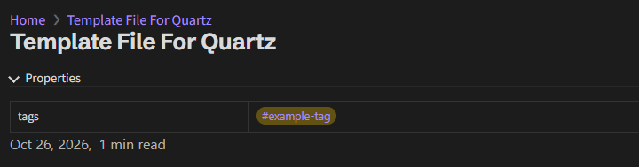
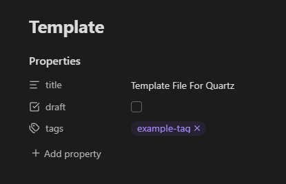

This is a example template file for Obsidian that Quartz utilizes special features from. Document properties can be added to the top of Obsidian documents like so:

```markdown
---
title: Template File For Quartz
draft: false
tags:
  - example-tag
---
```

Where it will look like this in the final page of the site:



And in Obsidian it will look like this:



The `draft` key when present and set to true allows for marking a page as incomplete and will not show it on the site.

The `tags` allows for adding tags to documents that relate to certain things which turn in links which can be searched for.

For more information, check out the Quartz documentation on [Authoring Content](https://quartz.jzhao.xyz/getting-started/authoring-content).
